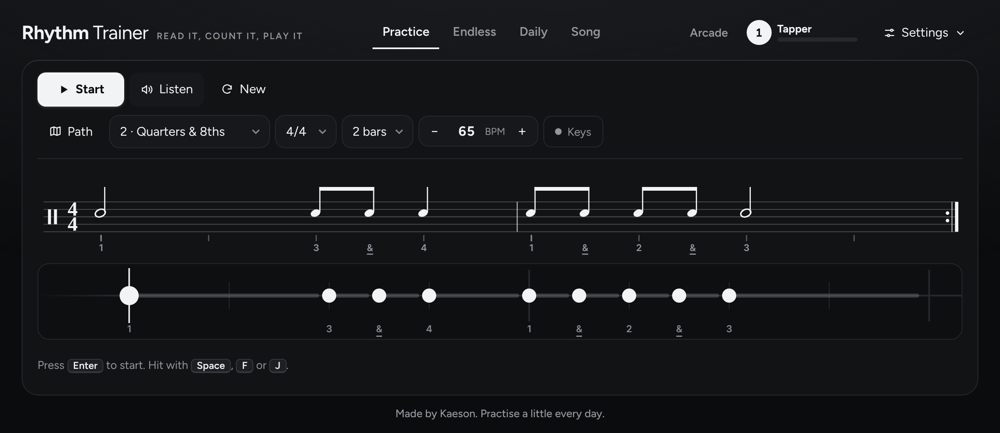
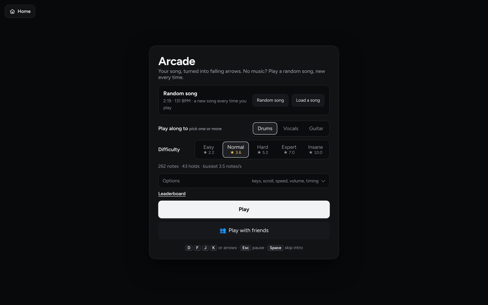
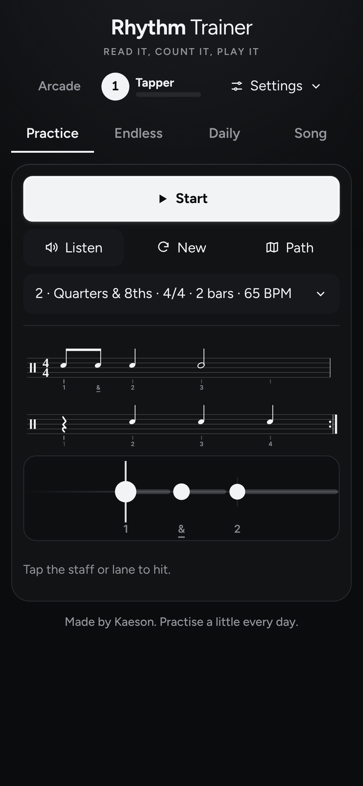

# Rhythm Trainer

**Read it, count it, play it.** Learn to read and play rhythms in your browser, then put them to the test in a falling-note arcade with your friends.

**▶ Play it:** https://pandasrevenge52.github.io/rhythm-trainer/

  

  
  &nbsp;
  

## The trainer
- Reads real rhythm notation: notes, rests, ties, tuplets and every polyrhythm from 2 to 9 against 2 to 5, in common and odd time signatures.
- Instant timing feedback on every hit, with a built-in metronome.
- **Practice**, **Endless**, **Daily** (a new challenge every day) and **Song** modes, plus a learning path that takes you from quarter notes upwards.
- Levels, XP and hundreds of achievements.
- Play with your keyboard, by tapping on a phone, or with a MIDI device or microphone. Latency calibration keeps your timing fair.

## The Arcade
- Load a song and it becomes falling arrows from its drums, vocals or guitar. No music? Play a random song, new every time.
- Five difficulties from Easy to Insane, with star ratings and a leaderboard.
- **Play with friends** online with an invite link or a short code. No sign-up needed.

## Good to know
- Free, no ads, no trackers, no account needed.
- Your progress stays in your browser. Back it up or move it to another device with a backup file, a save code or a QR code.
- Works offline once loaded, and can be installed like an app.
- Built with plain HTML, CSS and JavaScript: no framework and no build step.

Made by Kaeson.
